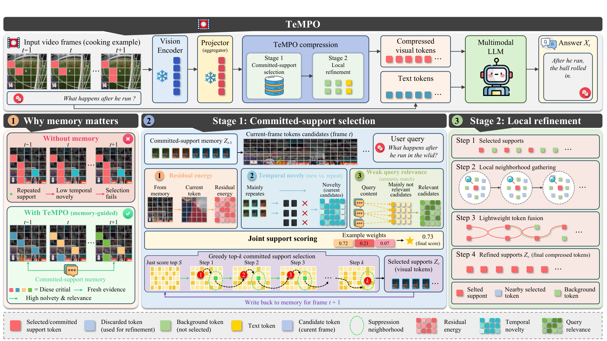

# TeMPO: Frame-Causal Token Compression for Video Reasoning

<p align="center">
  <b>NeurIPS 2026</b> ·
  <a href="https://laiyingxin2.github.io/TeMPO/">🌐 Project Page</a> ·
  <a href="#-citation">📚 Citation</a> ·
  <a href="LICENSE">⚖️ Apache-2.0</a>
</p>

Official implementation of **TeMPO**, a training-free, frame-causal visual token compression framework for video large language models (VLLMs).

> Existing training-free token compressors make retention decisions frame-locally, so selectors with different scoring rules repeatedly retain overlapping token supports across neighboring frames (**Selector Collapse**), spending the limited token budget on visual evidence already delivered to the language model. TeMPO turns frame-wise selection into a frame-causal decision process with three plug-and-play components: **committed-support memory** (CSM), **residual-energy greedy selection**, and **parameter-free neighborhood fusion** — no retraining, no backbone modification, no additional token budget.

<p align="center">
  
</p>

## 📰 News

- **[2026-11]** Code released.

## ✨ Highlights

- **Training-free plug-in**: one call, `model = tempo(model)` — no retraining, no backbone changes.
- **Frame-causal selection**: a committed-support memory records the token support already retained by earlier frames and is projected out of each new frame's candidates, so later frames spend their budget on *new* evidence.
- **Residual-energy greedy selector**: tokens are picked by the residual energy they explain after removing committed and already-selected directions, optionally blended with text-conditioned relevance.
- **Neighborhood fusion**: discarded tokens are merged into their nearest retained tokens to restore local visual coverage at zero extra token cost.

## 🛠️ Installation

```bash
git clone <this-repo>
cd TeMPO
conda create -n tempo python=3.10 -y
conda activate tempo
pip install -r requirements.txt
```

The repository vendors the needed parts of [LLaVA-NeXT](https://github.com/LLaVA-VL/LLaVA-NeXT) (`llava/`) and [lmms-eval](https://github.com/EvolvingLMMs-Lab/lmms-eval) (`lmms_eval/`), so no separate install of either is required. All commands below are run from the repository root.

## 🚀 Quick Start

```python
from llava.model.builder import load_pretrained_model
from tempo import tempo

tokenizer, model, image_processor, _ = load_pretrained_model(
    "lmms-lab/llava-onevision-qwen2-7b-ov", None, "llava_qwen",
    device_map="auto", multimodal=True,
)
model = tempo(model)  # that's it — visual tokens are now compressed at inference
```

Or try the end-to-end demo on a single video:

```bash
RETAIN_RATIO=0.10 python demo.py --video /path/to/video.mp4 --question "What happens after he opens the pot lid?"
```

### Configuration

All knobs are environment variables read at inference time:

| Variable | Default | Meaning |
| --- | --- | --- |
| `WRAPPER` | – | Method selector for lmms-eval runs: `tempo` (vectorized) or `tempo_v1` (loop-form reference) |
| `RETAIN_RATIO` | `0.25` | Fraction of visual tokens retained per frame (e.g. `0.10` = 10% budget) |
| `TEXT_ALPHA` | `0.15` | Weight of text-conditioned relevance in the joint selection score |
| `TEMPO_BASIS_CAP` | `48` | Size of the committed-support memory (number of basis vectors kept across frames) |

## 📊 Evaluation

Evaluation uses the vendored `lmms_eval` with task configs for VideoMME, LongVideoBench, MLVU, EgoSchema, and MVBench. The method is selected with the `WRAPPER` environment variable:

```bash
# LLaVA-OneVision-7B at 10% token retention
RETAIN_RATIO=0.10 bash scripts/eval_ov7b_tempo.sh

# LLaVA-Video-7B
RETAIN_RATIO=0.10 bash scripts/eval_llava_video_tempo.sh
```

which expands to:

```bash
WRAPPER=tempo RETAIN_RATIO=0.10 \
accelerate launch --num_processes 1 -m lmms_eval \
    --model llava_onevision \
    --model_args pretrained=lmms-lab/llava-onevision-qwen2-7b-ov,conv_template=qwen_1_5,model_name=llava_qwen,max_frames_num=32 \
    --tasks videomme,longvideobench_val_v,mlvu,egoschema \
    --batch_size 1 --log_samples --output_path ./logs/ov7b_tempo_r0.10
```

Unsetting `WRAPPER` runs the vanilla (uncompressed) backbone under the identical harness. Quantitative results are reported in the paper.

## 📁 Repository Structure

```
TeMPO/
├── tempo/                   # TeMPO method (vectorized + loop-form reference)
│   ├── llava_arch.py        #   committed-support memory + residual-energy selection + fusion
│   └── llava_arch_v1.py     #   readable reference implementation
├── method_wrappers/         # safe runtime binding of the method onto LLaVA classes
├── unified_token_pruning/   # shared runtime utilities
├── llava/                   # vendored LLaVA-NeXT (model side)
├── lmms_eval/               # vendored lmms-eval (evaluation side, video benchmarks)
├── scripts/                 # one-command evaluation scripts
└── demo.py                  # single-video quick start
```

## 🙏 Acknowledgements

This codebase builds on [LLaVA-NeXT](https://github.com/LLaVA-VL/LLaVA-NeXT) and [lmms-eval](https://github.com/EvolvingLMMs-Lab/lmms-eval). We also thank the authors of prior training-free token compression work, including FastV, SparseVLM, VisionZip, DivPrune, DyCoke, FastVID, and HoliTom, whose open-source releases shaped the structure of this repository.

## 📄 License

Apache License 2.0 (see [LICENSE](LICENSE)).

## 📚 Citation

```bibtex
@inproceedings{lai2026tempo,
  title     = {TeMPO: Frame-Causal Token Compression for Video Reasoning},
  author    = {Lai, Yingxin and Xu, Bo and Pan, Yun-ze and Zhu, Zhiliang and Sun, Baigui and Liu, Yang},
  booktitle = {Advances in Neural Information Processing Systems},
  year      = {2026}
}
```
